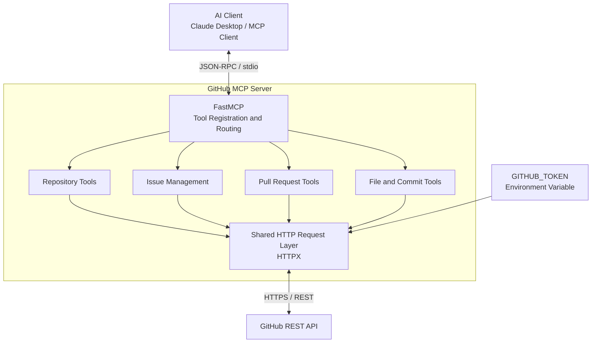

# GitHub MCP Server

[](https://github.com/OfficialBakang/github-mcp-server/actions/workflows/ci.yml)


[](LICENSE)


A Python-based Model Context Protocol (MCP) server that enables AI applications to interact with GitHub through 12 structured tools covering repository discovery, issue management, pull request inspection, source code retrieval and commit history.

Built to demonstrate practical AI tool integration, REST API engineering, Python packaging, automated testing and cross-platform continuous integration.

## Overview

AI assistants can reason about software development tasks, but they require external tools to access repository data and perform real-world operations.

This project bridges that gap by exposing GitHub REST API functionality through the Model Context Protocol.

Compatible AI clients can discover and invoke GitHub tools using structured parameters, enabling natural-language interactions with repositories without requiring users to manually construct API requests.

## Key Features

- 12 MCP-compatible GitHub tools.
- Repository discovery and metadata retrieval.
- Issue creation, inspection and updates.
- Pull request analysis and changed-file inspection.
- Source code and commit history retrieval.
- Token-based GitHub API authentication.
- Centralised HTTP request handling.
- Configurable result limits for collection endpoints.
- Installable Python package with a CLI entry point.
- 21 automated tests.
- Cross-platform GitHub Actions CI.

## System Architecture



### Request Lifecycle

1. An MCP-compatible client launches the server as a local subprocess.
2. The client discovers available tools and their input schemas.
3. A tool is invoked with structured arguments.
4. The server constructs an authenticated GitHub REST API request.
5. GitHub returns the requested data.
6. The server transforms the response into structured results.
7. The MCP client receives the results and uses them to complete the user's request.

## Technology Stack

| Technology | Purpose |
|---|---|
| Python | Core application development |
| Model Context Protocol | Standardised AI tool integration |
| FastMCP | MCP server and tool registration |
| HTTPX | HTTP communication |
| GitHub REST API | Repository data and operations |
| setuptools | Python packaging |
| pytest | Automated testing |
| pytest-mock | Mocking external dependencies |
| GitHub Actions | Continuous integration |
| Git | Version control |

## Available Tools

### Authentication

| Tool | Description |
|---|---|
| `get_authenticated_user` | Retrieve the authenticated account's profile. |

### Repository Management

| Tool | Description |
|---|---|
| `search_repositories` | Discover repositories using GitHub search queries. |
| `get_repository` | Retrieve repository metadata, language, topics and licence information. |

### Issue Management

| Tool | Description |
|---|---|
| `list_issues` | Retrieve issues with optional state and label filters. |
| `get_issue` | Inspect the details of a specific issue. |
| `create_issue` | Open an issue with a title, description and optional labels. |
| `update_issue` | Modify an existing issue, including its status and labels. |

### Pull Requests

| Tool | Description |
|---|---|
| `list_pull_requests` | Retrieve pull requests by state. |
| `get_pull_request` | Inspect pull request metadata and change statistics. |
| `list_pr_files` | Retrieve the files modified by a pull request. |

### Source Code and History

| Tool | Description |
|---|---|
| `get_file_contents` | Retrieve file contents from a repository. |
| `list_repository_commits` | Inspect recent commits and their authors. |

## Getting Started

### Prerequisites

- Python 3.11–3.14 (CI-tested versions).
- Git.
- A GitHub Personal Access Token.
- An MCP-compatible AI client for interactive usage.

Create a GitHub token at:

https://github.com/settings/tokens

### Clone the Repository

```bash
git clone https://github.com/OfficialBakang/github-mcp-server.git
cd github-mcp-server
```

### Installation — Windows (CMD)

```cmd
py -3.14 -m venv .venv
.venv\Scripts\activate.bat

python -m pip install --upgrade pip
python -m pip install -e ".[dev]"
```

Use another supported Python version if Python 3.14 is not installed.

### Installation — Linux / macOS

```bash
python3 -m venv .venv
source .venv/bin/activate

python -m pip install --upgrade pip
python -m pip install -e ".[dev]"
```

Linux and Windows are covered by automated CI. macOS installation instructions are provided but are not currently verified by the CI matrix.

### Verify Installation

```bash
python -m pip show github-mcp-server
python -m pip check
```

Verify the application entry point:

```bash
python -c "from server import main; assert callable(main); print('Entry point OK')"
```

## Configuration

The server reads authentication credentials from the `GITHUB_TOKEN` environment variable.

### Windows Command Prompt

```cmd
set "GITHUB_TOKEN=YOUR_GITHUB_TOKEN"
```

### Windows PowerShell

```powershell
$env:GITHUB_TOKEN = "YOUR_GITHUB_TOKEN"
```

### Linux / macOS

```bash
export GITHUB_TOKEN="YOUR_GITHUB_TOKEN"
```

Replace the placeholder locally with your token. Never commit real credentials.

## Running the Server

After activating the virtual environment:

```bash
github-mcp-server
```

Alternatively:

```bash
python server.py
```

The server communicates over standard input and output (stdio). It is intended to be launched by an MCP client rather than accessed as a conventional HTTP web server.

## Connecting to Claude Desktop

Open the Claude Desktop MCP configuration file and register the server.

### Windows Configuration

```json
{
  "mcpServers": {
    "github": {
      "command": "C:\\path\\to\\github-mcp-server\\.venv\\Scripts\\python.exe",
      "args": [
        "C:\\path\\to\\github-mcp-server\\server.py"
      ],
      "env": {
        "GITHUB_TOKEN": "YOUR_GITHUB_TOKEN"
      }
    }
  }
}
```

### Linux / macOS Configuration

```json
{
  "mcpServers": {
    "github": {
      "command": "/absolute/path/github-mcp-server/.venv/bin/python",
      "args": [
        "/absolute/path/github-mcp-server/server.py"
      ],
      "env": {
        "GITHUB_TOKEN": "YOUR_GITHUB_TOKEN"
      }
    }
  }
}
```

Replace the example paths with the actual installation paths and configure your token securely.

Restart the client after saving the configuration.

The available GitHub tools should then be discoverable by the MCP client.

## Example Use Cases

Once connected to an MCP-compatible client, users can issue natural-language requests such as:

### Repository Discovery

> Find five Python repositories related to retrieval-augmented generation and summarise their popularity and purpose.

### Issue Triage

> List the open issues labelled bug in my repository and summarise the main problems.

### Pull Request Inspection

> Inspect pull request #42 and summarise the modified files and change statistics.

### Source Code Exploration

> Retrieve server.py from my repository and explain its architecture.

### Commit History

> Summarise the ten most recent commits on the main branch.

### Issue Creation

> Draft an issue for the failing login workflow and create it after I confirm.

Write operations modify GitHub resources and should only be performed with explicit user approval.

## Automated Testing

The project includes 21 automated tests covering the behaviour of all 12 tool functions.

The test suite validates response transformations, optional fields, request construction, result limits and selected error scenarios.

### Run the Test Suite

```bash
python -m pytest test_server.py -v
```

### Verified Local Test Result

```text
21 passed in 1.64s
```

Recorded using Python 3.14.6 on Windows.

### Test Coverage Areas

| Component | Tests |
|---|---:|
| Authenticated user | 2 |
| Repository search | 3 |
| Repository metadata | 2 |
| Issue listing | 2 |
| Issue retrieval | 1 |
| Issue creation | 2 |
| Issue updates | 2 |
| Pull request listing | 1 |
| Pull request details | 1 |
| Pull request files | 1 |
| File content retrieval | 2 |
| Commit history | 2 |
| Total | 21 |

The passing test count is not a statement of 100% code coverage or live API integration coverage.

## Continuous Integration

GitHub Actions automatically validates the project on pushes and pull requests.

### CI Testing Matrix

| Python Version | Ubuntu | Windows |
|---|---|---|
| 3.11 | Passed | Passed |
| 3.12 | Passed | Passed |
| 3.13 | Passed | Passed |
| 3.14 | Passed | Passed |

All eight environments passed during repository-quality validation.

Each CI job:

1. Checks out the repository.
2. Configures the selected Python version.
3. Installs the project and development dependencies.
4. Checks for dependency conflicts.
5. Verifies the application entry point.
6. Executes the automated test suite.

View workflow results:

https://github.com/OfficialBakang/github-mcp-server/actions

## Engineering Decisions

### Standardised AI Tool Integration

MCP provides a common interface between AI applications and external tools, reducing the need for client-specific GitHub integrations.

### Centralised HTTP Layer

Shared HTTP helpers handle authentication, HTTP methods, response parsing and HTTP status errors.

This avoids duplicating request logic across individual tools.

### Explicit Dependency Constraints

The project currently targets MCP SDK v1 because it uses the FastMCP API.

An upper version constraint prevents incompatible MCP v2 releases from being installed unintentionally.

### Reproducible Installation

Python packaging is configured through pyproject.toml, allowing editable installation, development dependency management and CLI execution.

### Cross-Platform Validation

A CI matrix tests the package across multiple Python versions and operating systems to detect compatibility issues early.

## Security Considerations

- Credentials are supplied through environment variables.
- GitHub API requests use HTTPS and bearer authentication.
- HTTP requests use a configured timeout.
- Use fine-grained Personal Access Tokens where supported.
- Grant only the repository permissions required by your workflow.
- Prefer read-only tokens when write operations are unnecessary.
- Never commit tokens, environment secrets or client configuration containing credentials.
- Revoke and rotate any exposed credentials.

The server provides instructions encouraging confirmation before write operations. These instructions are not a server-enforced authorisation or approval mechanism.

AI clients should enforce explicit approval for operations that modify repository data.

Repository content retrieved by AI clients may contain untrusted instructions. Treat retrieved content as data, not trusted commands.

## Project Structure

```text
github-mcp-server/
├── .github/
│   └── workflows/
│       └── ci.yml
├── .gitignore
├── LICENSE
├── README.md
├── pyproject.toml
├── requirements.txt
├── server.py
└── test_server.py
```

| File | Responsibility |
|---|---|
| server.py | MCP server, GitHub tools and HTTP helpers |
| test_server.py | Automated tool-level tests |
| pyproject.toml | Package metadata and dependencies |
| requirements.txt | Runtime dependency declarations |
| ci.yml | Automated cross-platform validation |
| .gitignore | Exclusion of local environments and generated artifacts |

## Current Limitations

- Local stdio transport only.
- GitHub REST API only.
- Result limits rather than comprehensive automatic pagination.
- GitHub API rate limits apply.
- Synchronous HTTP requests.
- Write operations depend on the permissions of the configured token.
- MCP SDK v2 migration is not yet implemented.
- Live integration testing and macOS CI are not currently established.

## Roadmap

- [x] Implement 12 GitHub MCP tools.
- [x] Implement authenticated REST API requests.
- [x] Add automated tests.
- [x] Configure installable Python packaging.
- [x] Establish cross-platform CI.
- [ ] Add automatic pagination.
- [ ] Implement rate-limit-aware retries.
- [ ] Improve structured error reporting.
- [ ] Introduce server-enforced write-operation controls.
- [ ] Add pull request creation and review tools.
- [ ] Add GitHub Actions workflow inspection tools.
- [ ] Add macOS CI validation.
- [ ] Evaluate migration to MCP SDK v2.

## Contributing

Contributions, bug reports and feature suggestions are welcome.

1. Fork the repository.
2. Create a feature branch.
3. Implement your changes.
4. Add or update automated tests.
5. Run the test suite locally.
6. Submit a pull request.

## Author

**Bakang Mabilo**

Software Developer | AI Engineering | Full-Stack Development

BEngTech Electrical & Electronics Engineering — University of Johannesburg

[](https://github.com/OfficialBakang)
[](https://www.linkedin.com/in/oratile-mabilo/)

## License

This project is licensed under the MIT License.

See [LICENSE](LICENSE) for details.

---

Built to explore intelligent developer tooling, AI systems integration and reliable software engineering practices.

